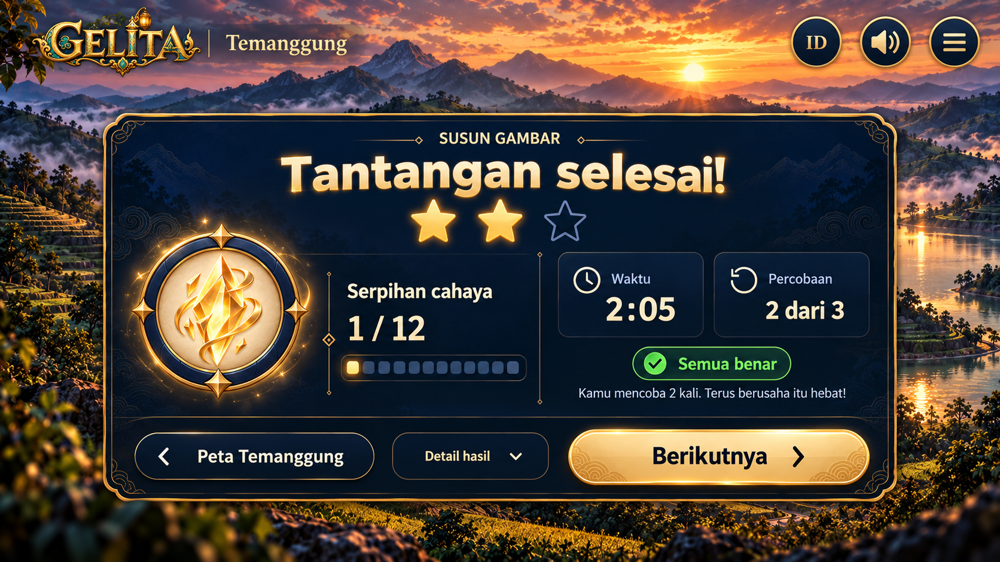

# Tantangan selesai — konsep bersama (contoh Temanggung)

**Mockup 01 dipilih pengguna pada 12 Oktober 2026.** Ini landscape pertama pada revisi terakhir, sebelum versi kedua yang memperbesar tombol. Semua rancangan memakai konteks aplikasi tetap 16:9 landscape.

**Konsep bersama lintas kota/wilayah:** halaman “Tantangan selesai” menggunakan satu desain dan satu komponen bersama untuk seluruh kota/wilayah game. Temanggung pada gambar dan nama folder hanya contoh penerapan. Kota aktif, jenis tantangan, latar, isi hasil, label peta, dan tujuan navigasi mengikuti konfigurasi serta state permainan.

**Referensi utama adalah gambar halaman lengkap beserta UI:** logo, nama wilayah, bahasa/speaker/menu pada HUD, panel hasil, bintang, medali/progres, dua kartu, badge, pesan, dan tiga tombol bawah. Lanskap tanpa UI hanya media pendukung.

## Paket UI lengkap

- [Buka preview UI interaktif](preview-ui-lengkap.html): kanvas tetap 16:9, HUD, tombol, menu, pilihan bahasa dan Detail hasil dapat dicoba.
- [Spesifikasi UI](spesifikasi-ui.md): ukuran, lapisan, sumber panel/tombol, dan perilaku setiap kontrol.
- Referensi visual hasil render kode: [halaman utama](variasi-ui/tampilan-utama/README.md), [bahasa terbuka](variasi-ui/bahasa-terbuka/README.md), [menu terbuka](variasi-ui/menu-terbuka/README.md), dan [Detail hasil terbuka](variasi-ui/detail-hasil-terbuka/README.md).
- Revisi 13 Oktober memakai enam gambar WebP baru untuk panel, tiga tombol, permukaan HUD dan bintang; efek medali menggunakan SVG. Kartu statistik serta overlay tetap SVG native. Semua delapan entri baru sudah masuk katalog.
- [Pemetaan dan prompt aset baru](../../../provenance/result-ui-generation-results-20261013.json) mencatat sumber, ukuran, alpha, hash dan prompt generasi.

Preview kode dan gambar keadaan terbuka melengkapi mockup 01. Keduanya bukan penggantian gambar pilihan dengan mockup kedua, bukan implementasi aplikasi, dan bukan gambar lanskap saja. Rute game, akun, dan hadiah belum dihubungkan.

| Dokumen | Isi |
|---|---|
| [Daftar berkas](list-file.md) | Lokasi dan fungsi setiap gambar, SVG, serta dokumen paket |
| [Keterangan mockup](keterangan-mockup.md) | Keputusan desain dan batas kesetiaan pada gambar |
| [Kebutuhan aset](kebutuhan-aset.md) | Aset yang cukup, aset baru, dan elemen yang dibuat dengan kode |
| [Prompt detail](prompt-detail.md) | Prompt lanskap yang benar-benar digunakan, brief reproduksi mockup, dan spesifikasi ikon SVG |
| [Petunjuk agen](petunjuk-agent.md) | Instruksi perombakan layar pada repositori web |
| [Provenance](../../../provenance/mockup-tantangan-selesai-temanggung.json) | Sumber pilihan, hash, generasi, dan pemetaan salinan aset |
| [Hasil pemeriksaan](../../../reports/mockup-reference-verification.json) | Pemeriksaan berkas, rasio, alpha, salinan, dan preservasi katalog |

Lanskap pendukung berada di [aset-baru/bg-tantangan-selesai-temanggung-3d.webp](aset-baru/bg-tantangan-selesai-temanggung-3d.webp). Lanskap merupakan gambar tanpa UI yang dibuat dengan acuan mockup; bagian yang semula tertutup panel direkonstruksi, sehingga tidak diklaim sebagai ekstraksi piksel persis. Penggantian lanskap saja tidak memenuhi tujuan perombakan UI ini.

Revisi bahasa terbaru: [bendera Indonesia](aset-katalog/bahasa-indonesia-flag.webp) dan [bendera UK untuk English](aset-katalog/bahasa-english-uk-flag.webp) mengganti medali huruf ID/EN pada preview. Keduanya sudah tersedia di katalog.
