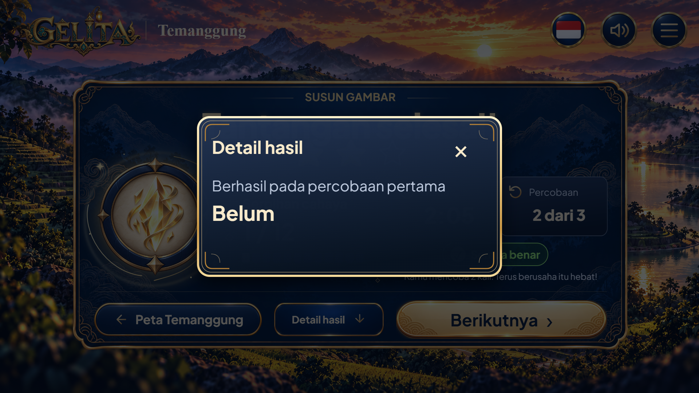

# Detail hasil terbuka

Informasi keberhasilan pada percobaan pertama ditampilkan dalam panel terpisah. Pada contoh hasil nilainya Belum; tidak menjadi kartu utama permanen.

## Daftar file dan keterangan

| Berkas | Keterangan |
|---|---|
| [mockup-ui-detail-hasil-terbuka-16-9.webp](mockup-ui-detail-hasil-terbuka-16-9.webp) | Gambar halaman UI lengkap, 1920 × 1080 WebP, hasil render kode. |
| [README.md](README.md) | Daftar file dan penjelasan keadaan ini. |

[Buka preview interaktif](../../preview-ui-lengkap.html), [spesifikasi UI](../../spesifikasi-ui.md), dan [gambar pilihan utama](../../mockup-tantangan-selesai-temanggung-16-9.webp).

Gambar ini menunjukkan state dari preview UI, bukan mockup pilihan kedua. Integrasi aplikasi asli belum dilakukan.

Cakupan: keadaan dari konsep UI hasil bersama lintas kota; Temanggung hanya data contoh pada render ini.
